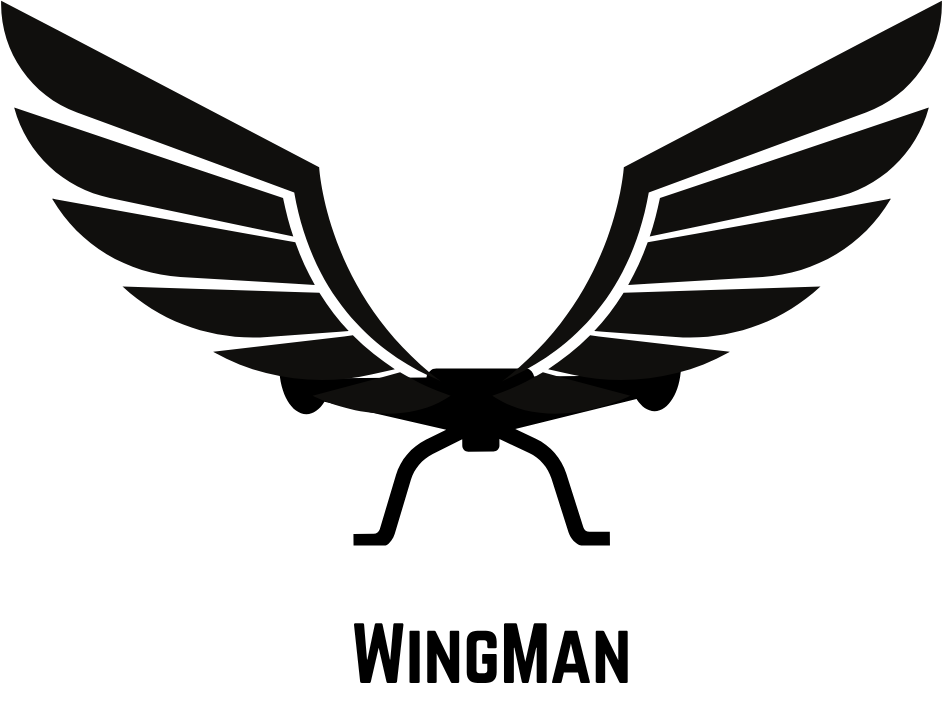
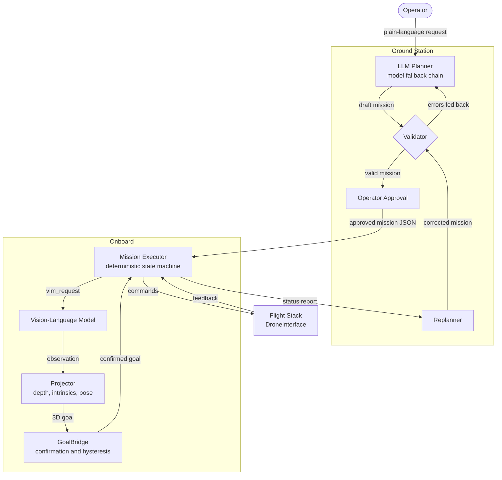
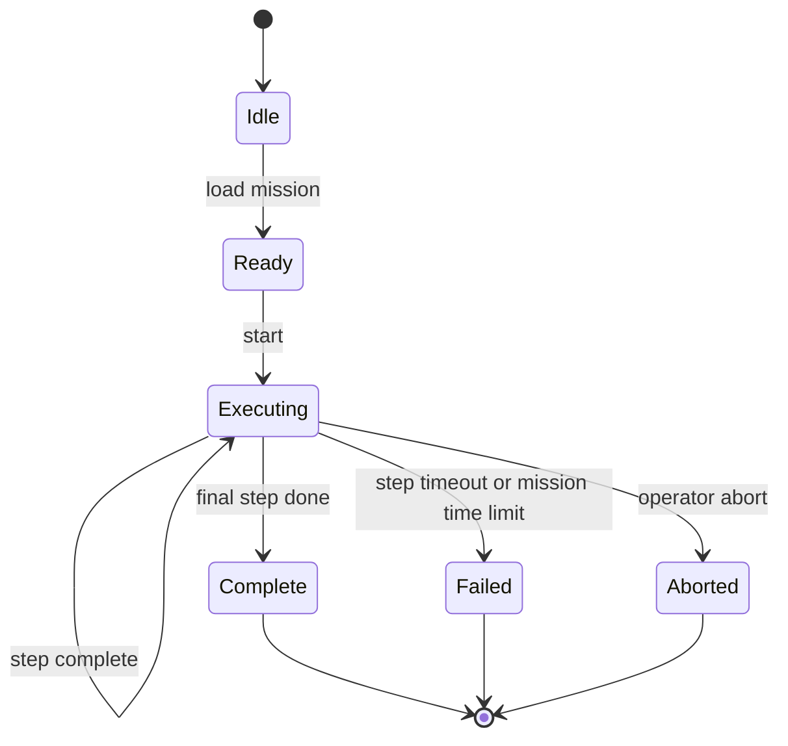
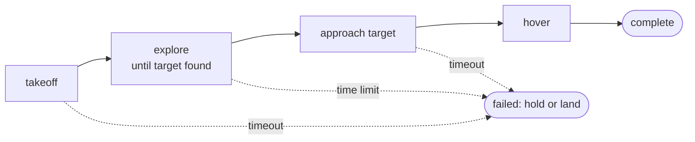

<div align = "center">
    
</div>


<p align="center">
  <strong>Autonomous indoor drone missions from plain-language requests</strong><br>
  Language-model planning, vision-language perception, and a deterministic onboard executor
</p>

---

WingMan is an autonomous indoor drone mission system that combines a ground-side language model planner with an onboard vision-language model (VLM) and a deterministic mission executor. An operator describes a task in plain language. The system converts it into a validated, bounded mission, requests operator approval, and executes it step by step, replanning when a mission fails.

The language model never issues motor, speed, or position commands. It selects actions from a fixed menu, and every mission passes through a strict validator before it can run.

## Status

The full software chain is implemented and tested in simulation. A simulated drone, still images in place of a camera, and constant depth stand in for hardware. Integration with a real flight stack, camera stream, depth sensor, and odometry is pending. See [Hardware integration](#hardware-integration).

## Architecture

### System overview



### Executor lifecycle



### Typical mission flow



### Components

| Package | Path | Responsibility |
|---|---|---|
| `wingman-ground` | `ground/` | Mission schema, validator, LLM client, planner, replanner |
| `wingman-vlm` | `vlm/` | VLM client and server scripts, schema, goal projector, GoalBridge |
| `wingman-onboard` | `onboard/` | Mission executor and simulation helpers |
| Scripts | `scripts/` | End-to-end runner |

## Safety Model

- **Fixed action menu.** The planner may only choose from: `takeoff`, `explore`, `approach_target`, `hover`, `return_to_start`, and `land`.
- **Bounded limits.** Maximum speed, altitude, step count, and mission time are enforced by the validator, and the same limits are injected into the planner prompt.
- **Re-validation onboard.** The executor validates every mission again on load. It does not trust the link between ground and drone.
- **Prompt-injection resistance.** Operator requests and drone status reports are passed to the LLM as delimited data, and the mission identifier is always assigned by the system, never by the model.
- **Human approval.** Every mission, including replans, requires explicit operator approval before execution.
- **Defined failure behavior.** Timeouts and the mission time limit cause a controlled failure, after which the drone holds position by default or lands if configured.

The executor is not a certified safety system. A real deployment must retain the flight controller's own limits, geofence, battery failsafe, and a manual override.

## Requirements

- Python 3.10 or newer
- A running VLM server for the vision pipeline (`vlm/scripts/run_server.sh`)
- An API key for an OpenAI-compatible chat completions endpoint (OpenRouter by default)

## Installation

```bash
git clone <repository-url> WingMan
cd WingMan

python -m venv vlm/.venv
source vlm/.venv/bin/activate

pip install -e ground
pip install -e vlm
pip install -e onboard
```

## Configuration

Create a `.env` file in the repository root. This file must never be committed.

```bash
LLM_API_KEY=<your key>
LLM_BASE_URL=https://openrouter.ai/api/v1
LLM_MODEL=nvidia/nemotron-3-ultra-550b-a55b:free
LLM_FALLBACK_MODELS=nvidia/nemotron-3.5-lightning:free,nvidia/nemotron-3-nano-omni-30b-a3b-reasoning:free
LLM_MAX_TOKENS=3000
LLM_DEADLINE_S=45
```

| Variable | Description |
|---|---|
| `LLM_API_KEY` | API key for the LLM endpoint |
| `LLM_BASE_URL` | Base URL of an OpenAI-compatible API |
| `LLM_MODEL` | Primary model |
| `LLM_FALLBACK_MODELS` | Comma-separated models tried in order if the primary fails |
| `LLM_MAX_TOKENS` | Maximum tokens per completion |
| `LLM_DEADLINE_S` | Hard wall-clock limit per request, in seconds |

The client retries rate-limited and server-error responses, then moves to the next model on errors, empty output, or a missed deadline. Authentication errors stop immediately.

## Usage

Load the environment, start the VLM server in a separate terminal, then run the end-to-end script:

```bash
set -a; source .env; set +a

python scripts/run_wingman.py "take off, find the red box, then hover over it"
```

The script plans a mission, displays it for approval, flies it on the simulated drone, and saves a run log under `ground/out/`.

To demonstrate failure recovery, stall the first takeoff and let the replanner propose a new mission:

```bash
python scripts/run_wingman.py --inject-failure "take off, find the red box, then hover over it"
```

| Option | Description |
|---|---|
| `--yes` | Auto-approve missions |
| `--inject-failure` | Stall the first takeoff to exercise replanning |
| `--max-replans N` | Maximum number of replans (default 2) |
| `--images PATH` | Folder of images used as the simulated camera |

To generate a mission without flying it:

```bash
python ground/scripts/plan.py "solve the following maze"
```

If a request is unclear or exceeds the limits, the planner returns a clarification question rather than an unsafe mission.

## Mission Format

A mission is a single JSON object:

```json
{
  "mission_id": "m_20261026_140424",
  "goal": "find and hover over the red box",
  "target": "red box",
  "steps": [
    {"action": "takeoff", "altitude_m": 1.0},
    {"action": "explore", "strategy": "frontier", "until": "target_found"},
    {"action": "approach_target", "standoff_m": 0.5},
    {"action": "hover", "duration_s": 10.0}
  ],
  "limits": {"max_speed_mps": 0.5, "max_altitude_m": 2.0, "max_time_s": 300},
  "success_condition": "drone is hovering over the red box"
}
```

The first step must be `takeoff`, the last must be `hover` or `land`, and steps that search for something require a `target`. The full set of constraints and maximum values is defined in `ground/src/wingman_ground/mission.py`.

## Hardware Integration

The executor has no ROS dependency. A flight stack integrates by implementing `DroneInterface` and driving the executor from its own loop:

1. Call `executor.tick(now, Feedback(...))` at 5 to 10 Hz.
2. Call `executor.vlm_request()`. If it returns `None`, skip inference.
3. Otherwise run the VLM, project the detection to a 3D goal using real depth, camera intrinsics, and odometry, and call `executor.on_observation(obs, goal, now)`.
4. Periodically send `executor.status(now)` to the ground station.

Use a single monotonic clock for every `now` value. Replace the simulated components as follows:

| Simulated | Replace with |
|---|---|
| Identity pose | Odometry pose at frame capture time |
| Constant 3 m depth | Aligned depth image in meters |
| Still images | Camera stream |
| `SimDrone` | A `DroneInterface` implementation for the flight stack |

## Testing

```bash
cd ground && python -m pytest -q    # planner, replanner, validator, LLM client
cd ../onboard && python -m pytest -q  # mission executor
```

Tests use fake LLM and drone implementations and do not require network access, a GPU, or a simulator.

## Repository Layout

```
ground/
  src/wingman_ground/   mission schema, validator, llm_client, prompts, planner, replanner
  scripts/plan.py       generate a mission from a request
  tests/
onboard/
  src/wingman_onboard/  executor, sim helpers
  tests/
vlm/
  src/wingman_vlm/      client, schema, projector, bridge
  scripts/              VLM server launcher
  eval/data/            sample images used by the simulation
scripts/
  run_wingman.py        end-to-end runner
dashboard/
  src/wingman_dashboard/ FastAPI dashboard, live link, map, and camera
  static/index.html     browser control interface
ros2/
  wingman_ros/          ROS 2 Humble map, RGB-D, PX4 telemetry, and health bridge
```

## Known Limitations

- Validation has been performed only against a simulated drone with still images and constant depth.
- After a failure the executor holds position indefinitely by default. A hover timeout followed by landing is planned for hardware.
- The default LLM chain uses free endpoints, which may be rate limited, change, or become unavailable. Verify the chain before any demonstration.
- Replanning relies on the language model's judgment and is not guaranteed to resolve the underlying fault.
- ROS 2 telemetry and perception integration is available under `ros2/wingman_ros`.
- Autonomous ROS command publication is intentionally disabled until the
  EGO-Planner goal and PX4 command interfaces are finalized and tested.

### Remote website monitoring without ROS on the laptop

ROS only needs to run on the simulator/flight computer. The browser can
connect to that machine through `rosbridge_server` and `web_video_server`.
Open the dashboard in remote monitor mode:

```text
http://DASHBOARD_HOST:8000/?ros_ws=ws%3A%2F%2FROS_HOST%3A9090&video=http%3A%2F%2FROS_HOST%3A8080%2Fstream%3Ftopic%3D%252Fcamera%252Fcolor%252Fimage_raw
```

This mode is read-only and shows the remote camera, map, telemetry, and
stale-data warnings. ROS is not installed on the laptop. The ROS host must
run `rosbridge_server`, `web_video_server`, and `wingman_ros`; keep ports
9090 and 8080 private or protect them with a VPN/authenticated proxy.

## License

Copyright (c) 2026 Manabendu Karfa and Archisman Rana. All rights reserved.
 
This software and its associated documentation are proprietary and confidential. No part of this repository may be copied, modified, merged, published, distributed, sublicensed, sold, or used, in whole or in part, for any purpose without the prior written permission of the copyright holders, Manabendu Karfa and Archisman Rana.
 
The software is provided "as is", without warranty of any kind, express or implied, including but not limited to the warranties of merchantability, fitness for a particular purpose, and non-infringement. In no event shall the copyright holders be liable for any claim, damages, or other liability arising from, out of, or in connection with the software or its use. This software controls a flying vehicle, and any use of it with physical hardware is entirely at the user's own risk.
 
For permission requests, contact the copyright holders.
 