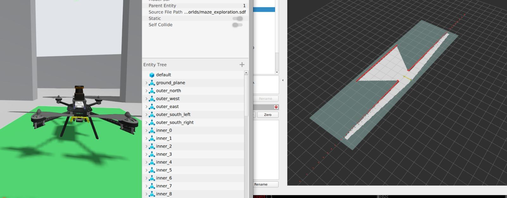
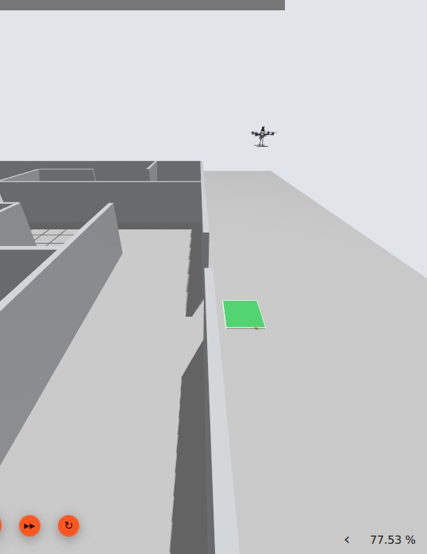
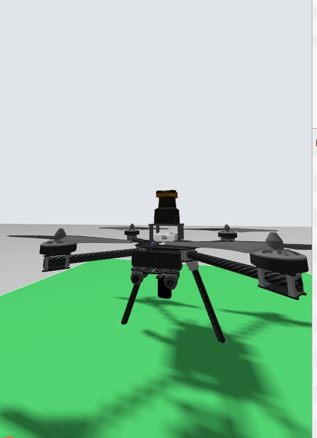
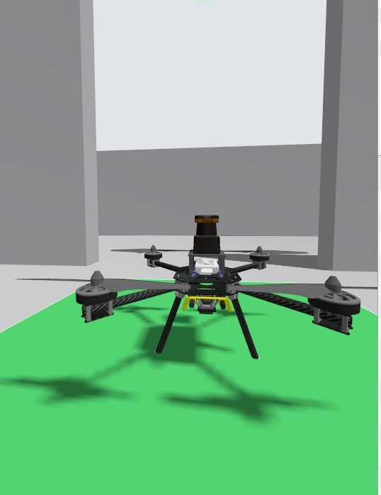
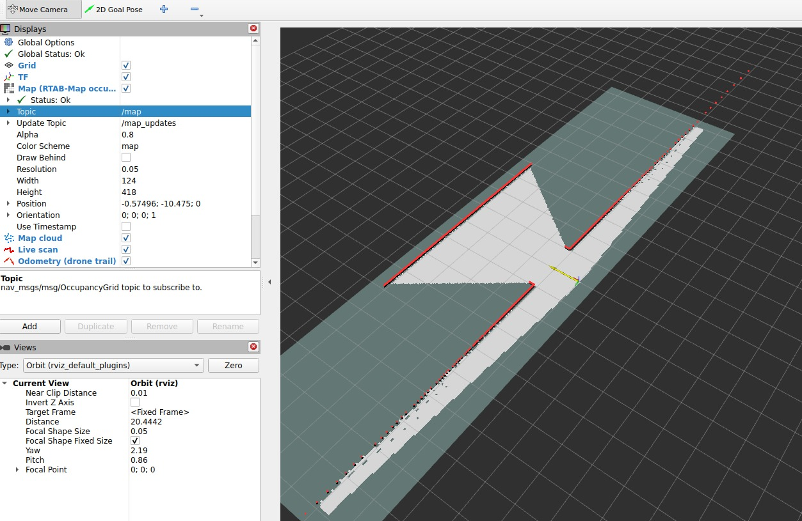
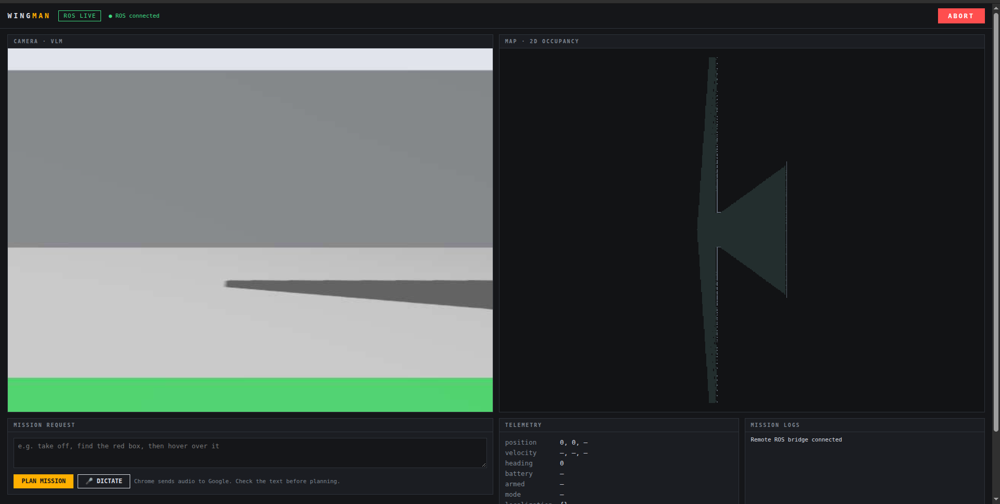
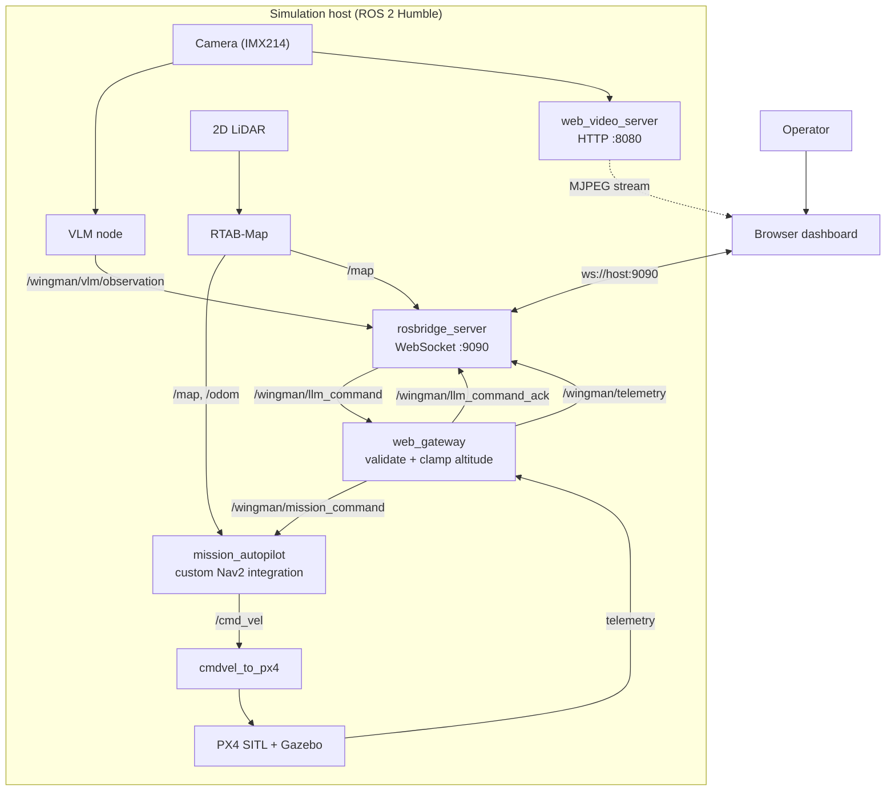

<div align="center">
  
  <p>
    <strong>Plain-language autonomous indoor-drone missions</strong><br>
    LLM mission planning · VLM perception · ROS 2 · PX4 SITL · Gazebo · Nav2
  </p>
</div>

<p align="center">
  
</p>

WingMan is an indoor-drone mission system that turns an operator's natural
language request into a bounded mission and sends it through a validated ROS 2
gateway to a PX4/Gazebo flight stack. The current simulation combines:

- PX4 SITL and Gazebo's `maze_exploration` world;
- 2D LiDAR localization and RTAB-Map occupancy mapping;
- a custom Nav2-based mission autopilot;
- a rangefinder-based altitude controller;
- a VLM pipeline for target-finding missions;
- a browser dashboard connected through `rosbridge_server`;
- an MJPEG camera stream provided by `web_video_server`.

> **Safety status:** This repository is a simulation and SITL integration
> project. It is not a certified flight-control or safety system. Do not use
> it on physical aircraft without an independent flight-controller failsafe,
> geofence, battery failsafe, manual override, and a qualified flight test
> procedure.

## Project status

| Area | Status |
|---|---|
| Mission schema and validation | Implemented and tested |
| Ground LLM planning and replanning | Implemented |
| Deterministic Python executor | Implemented and simulated |
| PX4 SITL/Gazebo maze startup | Available in `simulation/` |
| LiDAR bridge and RTAB-Map mapping | Available in the simulation workspace |
| Website camera stream | Available through `web_video_server` |
| Website telemetry/map/mission channels | Available through `rosbridge_server` |
| VLM target-finding path | Available when the VLM node/server is running |
| Physical-flight certification | Not provided |

## Demonstration gallery

<p align="center">
  
  
  
</p>

<p align="center">
  
  
</p>

## Architecture



### Repository packages

| Package | Location | Responsibility |
|---|---|---|
| Ground | `ground/` | Mission schema, validator, planner, LLM client, replanner |
| VLM | `vlm/` | VLM client, observation schema, depth projection, goal bridge |
| Onboard | `onboard/` | Deterministic executor and offline simulation |
| Dashboard | `dashboard/` | FastAPI dashboard and browser frontend |
| ROS bridge | `ros2/wingman_ros/` | Generic ROS 2 state/telemetry bridge |
| Simulation | `simulation/` | PX4/Gazebo, bridges, RTAB-Map, Nav2, and website launch files |

## Mission and command model

The website publishes one JSON string to:

```text
/wingman/llm_command
std_msgs/msg/String
```

The `web_gateway` validates the request, clamps altitude, and acknowledges it
on:

```text
/wingman/llm_command_ack
std_msgs/msg/String
```

Supported command types:

```text
explore | find | goto | return | takeoff | land | hover
```

`then` may be:

```text
return | land | hover | continue
```

Altitude is in metres and is clamped by the gateway to `0.4`–`2.0 m`.
Command IDs are strings; repeating the same ID within the gateway's retry
window is ignored safely.

Examples:

```json
{"id":"42","type":"explore","then":"return","altitude":0.75}
```

```json
{"id":"43","type":"find","target":"person","then":"return","altitude":0.75}
```

```json
{"id":"44","type":"goto","xy":[4,-10],"then":"hover"}
```

```json
{"id":"45","type":"return"}
```

```json
{"id":"46","type":"land"}
```

The website also accepts an operator prompt:

```json
{"id":"48","prompt":"explore the maze and return to home while maintaining height of 0.75 m"}
```

## ROS and website interfaces

### Website subscriptions

| Topic | Type | Publisher | Purpose |
|---|---|---|---|
| `/wingman/telemetry` | `std_msgs/msg/String` JSON | `web_gateway` | Main dashboard feed |
| `/wingman/llm_command_ack` | `std_msgs/msg/String` JSON | `web_gateway` | Command acceptance/rejection |
| `/map` | `nav_msgs/msg/OccupancyGrid` | RTAB-Map | Occupancy map |
| `/wingman/planner_debug/path` | `nav_msgs/msg/Path` | `mission_autopilot` | Planned path |
| `/wingman/planner_debug/goal_marker` | `visualization_msgs/msg/Marker` | `mission_autopilot` | Current goal |
| `/wingman/mission_status` | `std_msgs/msg/String` JSON | `mission_autopilot` | Raw mission state |
| `/wingman/flight_state` | `std_msgs/msg/String` JSON | `cmdvel_to_px4` | Raw PX4 bridge state |
| `/wingman/vlm/observation` | `std_msgs/msg/String` JSON | `vlm_node` | Scene and target detections |

The website connects through:

```text
ws://<drone-host>:9090
```

### Camera stream

The camera is an MJPEG HTTP stream, not a ROS WebSocket message:

```text
http://<drone-host>:8080/stream?topic=/world/maze_exploration/model/x500_gps_denied_0/link/camera_link/sensor/IMX214/image&type=mjpeg&quality=60
```

### Telemetry JSON

`/wingman/telemetry` contains:

```json
{
  "flight_state": "idle|prestream|arming|climbing|flying|landing|error",
  "height_m": 0.0,
  "target_height_m": 0.75,
  "range_ok": true,
  "baro_height_m": 0.0,
  "ready": true,
  "mission_state": "IDLE|TAKEOFF|EXPLORE|GOTO|RETURN|CONFIRM|HOVER|LANDING",
  "mission": {"type":"explore","target":null,"then":"return","altitude":0.75},
  "pose": [0.0, 0.0, 90.0],
  "goal": [0.0, 0.0],
  "found": [],
  "elapsed_s": 0.0,
  "last": "latest human-readable status",
  "stale": {"flight": false, "mission": false}
}
```

## Prerequisites

The simulation host should run:

- Ubuntu 22.04;
- ROS 2 Humble;
- PX4-Autopilot with Gazebo support;
- Gazebo Sim;
- Micro XRCE-DDS Agent;
- RTAB-Map and `rtabmap_msgs`;
- Nav2 and the WingMan simulation workspace;
- `rosbridge_server`;
- `web_video_server`;
- Python 3.10+ for the Python packages.

ROS is required on the simulation host. It does **not** need to be installed
on a laptop used only to open the website; the laptop needs network access to
ports `9090` and `8080`.

## PX4 external-vision parameters

For GPS-denied external-vision operation, configure the following PX4
parameters in the SITL vehicle:

| Parameter | Value | Meaning |
|---|---:|---|
| `EKF2_EV_CTRL` | `9` | Enables the configured external-vision fusion modes; verify bit semantics for the PX4 version |
| `EKF2_HGT_REF` | `2` | Selects the configured EKF2 height reference |
| `EKF2_EV_DELAY` | `50 ms` | Compensates for external-vision measurement delay |
| `EKF2_EVP_NOISE` | `0.10` | External-vision position noise |
| `EKF2_EVV_NOISE` | `0.10` | External-vision velocity noise |
| `EKF2_EVA_NOISE` | `0.10` | External-vision attitude noise |
| `EKF2_GPS_CTRL` | `0` | Disables GPS aiding in EKF2 |

Apply and verify them using the PX4 console/QGroundControl for the exact PX4
release in use. Parameter meanings and bit definitions can change between
releases; do not assume a parameter is correct without checking estimator
health and the vehicle logs.

## Installation

### Python packages

```bash
cd ~/WingMan
python3 -m venv vlm/.venv
source vlm/.venv/bin/activate

python -m pip install --upgrade pip
python -m pip install -e ground -e vlm -e onboard -e dashboard
```

### Simulation workspace

The simulation workspace is expected at `~/ws_wingman` on the simulation
host. Build it using the workspace's own instructions, then source:

```bash
source /opt/ros/humble/setup.bash
source ~/ws_ros2/install/setup.bash
source ~/ws_wingman/install/setup.bash
```

## Full WingMan simulation startup

Run the following on the **simulation host**. Keep each block in its own
terminal. The order matters.

### Terminal 1 — PX4 SITL and Gazebo

```bash
cd ~/PX4-Autopilot
PX4_GZ_WORLD=maze_exploration \
PX4_GZ_MODEL_POSE="0,-17.2,0.3,0,0,1.5708" \
make px4_sitl gz_x500_gps_denied
```

### Terminal 2 — Micro XRCE-DDS Agent

```bash
MicroXRCEAgent udp4 -p 8888
```

### Terminal 3 — LiDAR bridge

```bash
source /opt/ros/humble/setup.bash
source ~/ws_ros2/install/setup.bash
source ~/ws_wingman/install/setup.bash
~/ws_wingman/scripts/bridge_lidar.sh \
  '/world/maze_exploration/model/x500_gps_denied_0/link/link/sensor/lidar_2d_v2/scan' \
  scan
```

### Terminal 4 — Camera bridge

Required for `find ...` missions:

```bash
source /opt/ros/humble/setup.bash
source ~/ws_ros2/install/setup.bash
source ~/ws_wingman/install/setup.bash
ros2 run ros_gz_bridge parameter_bridge \
  '/world/maze_exploration/model/x500_gps_denied_0/link/camera_link/sensor/IMX214/image@sensor_msgs/msg/Image[gz.msgs.Image'
```

Do not run a second camera bridge if the website launch file already starts
one.

### Terminal 5 — Localization and mapping

```bash
source /opt/ros/humble/setup.bash
source ~/ws_ros2/install/setup.bash
source ~/ws_wingman/install/setup.bash
ros2 launch ~/ws_wingman/launch/maze_bringup.launch.py \
  with_nav:=false \
  lidar_frame:=link \
  lidar_xyz:="0 0 0.075"
```

RViz should open and the occupancy map should begin building.

### Terminal 6 — Flight stack

```bash
source /opt/ros/humble/setup.bash
source ~/ws_ros2/install/setup.bash
source ~/ws_wingman/install/setup.bash
ros2 launch wingman_exploration mission.launch.py \
  vlm:=false \
  takeoff_alt:=0.75
```

This starts the custom mission/autopilot path. The VLM is disabled here while
the initial map and localization warm up.

### Terminal 7 — VLM command-line node

```bash
source /opt/ros/humble/setup.bash
source ~/ws_ros2/install/setup.bash
source ~/ws_wingman/install/setup.bash
ros2 run wingman_vlm prompt_cli
```

### Terminal 8 — Website stack

```bash
source /opt/ros/humble/setup.bash
source ~/ws_ros2/install/setup.bash
source ~/ws_wingman/install/setup.bash
ros2 launch wingman_exploration website.launch.py \
  rosbridge:=false \
  video:=false \
  camera_bridge:=false
```

Use the disabled flags when rosbridge, video, and camera bridging are started
manually in separate terminals. If the launch file owns those services,
enable them there instead and do not start duplicate nodes.

### Terminal 9 — rosbridge WebSocket

```bash
source /opt/ros/humble/setup.bash
source ~/ws_ros2/install/setup.bash
source ~/ws_wingman/install/setup.bash
ros2 launch rosbridge_server rosbridge_websocket_launch.xml \
  unregister_timeout:=100.0 \
  max_message_size:=10000000
```

### Terminal 10 — web video server

```bash
source /opt/ros/humble/setup.bash
ros2 run web_video_server web_video_server
```

Find the simulation host address for the website:

```bash
hostname -I
```

Allow TCP ports `9090` and `8080` through the host firewall if the browser is
on another machine.

## Start the website without ROS on the laptop

On the laptop, activate the Python environment and run:

```bash
cd ~/WingMan
source vlm/.venv/bin/activate

python -m wingman_dashboard \
  --mock \
  --host 0.0.0.0 \
  --port 8000 \
  --remote-video \
  'http://<drone-host>:8080/stream?topic=/world/maze_exploration/model/x500_gps_denied_0/link/camera_link/sensor/IMX214/image&type=mjpeg&quality=60' \
  --remote-ros-ws 'ws://<drone-host>:9090' \
  --enable-remote-commands
```

Open:

```text
http://127.0.0.1:8000/
```

The `--mock` option here only selects the local dashboard's fallback planner
objects; the remote command and telemetry channels are provided by the
simulation host through rosbridge. The browser dashboard is read-only unless
`--enable-remote-commands` is supplied.

## VLM workflow

The VLM is required for `find` missions, not for basic exploration. Allow the
mapping/localization stack to warm up first. Then run the VLM node and issue a
find command through the website or the command topic.

The VLM output is published on:

```text
/wingman/vlm/observation
std_msgs/msg/String
```

It should contain scene text, target visibility, normalized target coordinates,
confidence, uncertainties, and the suggested next step. A target should only
be acted upon after confidence, depth, and repeated-observation checks pass.

## Test commands without the website

Monitor acknowledgements:

```bash
ros2 topic echo /wingman/llm_command_ack
```

Send a safe hover command:

```bash
ros2 topic pub --once /wingman/llm_command std_msgs/msg/String \
  "{data: '{\"id\":\"t1\",\"type\":\"hover\"}'}"
```

Send a SITL exploration command:

```bash
ros2 topic pub --once /wingman/llm_command std_msgs/msg/String \
  "{data: '{\"id\":\"t2\",\"type\":\"explore\",\"then\":\"return\",\"altitude\":0.75}'}"
```

Monitor telemetry and altitude:

```bash
ros2 topic echo /wingman/telemetry
ros2 topic echo /wingman/range --once
```

Stop or hold the vehicle:

```bash
ros2 topic pub --once /wingman/llm_command std_msgs/msg/String \
  "{data: '{\"id\":\"stop-1\",\"type\":\"hover\"}'}"
```

## Verification checklist

Before issuing a takeoff command:

- [ ] PX4 SITL is healthy and the expected Gazebo world is loaded.
- [ ] Micro XRCE-DDS Agent is connected.
- [ ] `/scan` is publishing.
- [ ] `/odom` is publishing and localization is stable.
- [ ] `/map` is publishing and updating.
- [ ] External-vision/GPS-denied PX4 parameters are verified.
- [ ] The rangefinder is publishing and `range_ok` is true when expected.
- [ ] `/wingman/telemetry` reports `ready: true`.
- [ ] `/wingman/llm_command_ack` is visible.
- [ ] The website shows the current camera and map.
- [ ] A hover command has been tested.
- [ ] A land command has been tested.

During a mission:

- Stop immediately if telemetry becomes stale.
- Stop if localization health degrades.
- Stop if the rangefinder becomes invalid unexpectedly.
- Use `hover` or `land` through the command topic as appropriate.
- Keep the PX4 manual override available.

## Useful diagnostics

```bash
ros2 topic list
ros2 topic hz /map
ros2 topic hz /odom
ros2 topic hz /wingman/telemetry
ros2 topic hz /wingman/flight_state
ros2 topic echo --once /wingman/llm_command_ack
ros2 topic echo --once /wingman/telemetry
ros2 topic echo --once /wingman/mission_status
```

Check the browser-facing services:

```bash
curl -I 'http://<drone-host>:8080/stream?topic=/world/maze_exploration/model/x500_gps_denied_0/link/camera_link/sensor/IMX214/image&type=mjpeg&quality=60'
```

For rosbridge, confirm the WebSocket server is listening:

```bash
ss -ltnp | grep -E ':9090|:8080'
```

## Python test suite

```bash
source vlm/.venv/bin/activate
python -m pytest -q ground/tests
python -m pytest -q onboard/tests
python -m pytest -q vlm/tests
python -m pytest -q dashboard/tests
```

The ROS bridge's ROS-independent tests can be run without ROS:

```bash
PYTHONPATH=ros2/wingman_ros python -m pytest -q ros2/wingman_ros/tests
```

## Known limitations

- The simulation command gateway is the authority for command validation and
  altitude clamping; the browser is not a flight-safety boundary.
- The VLM may be unavailable or slow; exploration should continue according
  to the configured mission policy.
- RGB-D calibration, TF frames, and depth units must match the simulation
  configuration before using 3D target projection.
- `web_video_server` and rosbridge are not authenticated by default. Keep them
  on a trusted LAN or behind a VPN/authenticated reverse proxy.
- Do not expose `/wingman/llm_command` to an untrusted network.
- The generic bridge in `ros2/wingman_ros/` is separate from the friend's
  `web_gateway`; run only the bridge that owns the topics in your workspace.

## Related documentation

- [Simulation workspace](simulation/README.md)
- [Website interface](simulation/docs/WEBSITE_INTERFACE.md)
- [Simulation architecture](simulation/docs/ARCHITECTURE.md)
- [Simulation troubleshooting](simulation/docs/TROUBLESHOOTING.md)
- [ROS interface contract](docs/interfaces.md)
- [Dashboard guide](dashboard/README.md)

## License

Copyright (c) 2026 Manabendu Karfa and Archisman Rana. All rights reserved.

This software and its associated documentation are proprietary and
confidential. No part of this repository may be copied, modified, merged,
published, distributed, sublicensed, sold, or used, in whole or in part,
without prior written permission from the copyright holders.

The software is provided "as is", without warranty of any kind. This software
controls a flying vehicle; any use with physical hardware is entirely at the
user's own risk.
